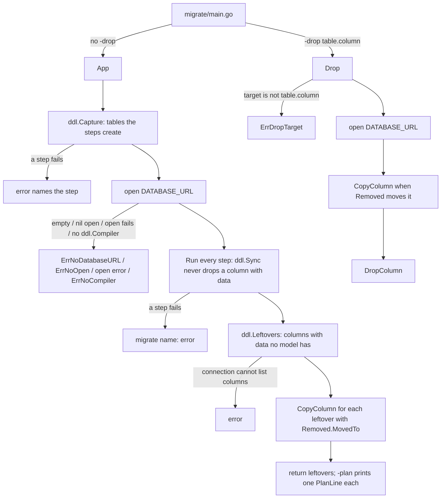

> Read AGENTS.md at the repo root before any change.
> **Finish by yourself:** when the delivery check passes, commit, push and open the pull request. Never ask whether to
> proceed or finalize — nobody answers, and a session that waits ends without your work.

# migrate: leftover columns, `-plan` and `-drop`

## Tools

```bash
go install webtyp.com/devflow/cmd/gotest@latest
go get webtyp.com/ddl@v0.0.45
go get webtyp.com/sqlite@v0.3.30
go mod tidy
```

Environment: `GOPRIVATE=webtyp.com/*,github.com/veltylabs/*`, `GOFLAGS=-mod=mod`. This repo has no `lang.json` and its
errors are `errors.New` in English: keep that style, do not add `langc`.

## Why

When a model loses a field, `ddl.Sync` keeps the column if it still holds data, and nobody sees it. `ddl` v0.0.45 can
now list those columns (`Leftovers`), copy one into another (`CopyColumn`) and drop one (`DropColumn`). This plan makes
`migrate` — the whole body of every app's generated `migrate/main.go` — use them:

- `App` also receives the app's `[]ddl.Removed` (generated later into `config/removed.go`, not by this repo), copies
  every leftover column whose `Removed.MovedTo` is set, and **returns** the leftover columns. It never drops a column.
- `Drop` drops one column on request (`-drop table.column`), copying it first when `Removed.MovedTo` says so.
- `PlanLine` prints one leftover as one JSON line, for `-plan` (read by webtyp dev and by an agent over MCP).

The flags themselves are parsed by the generated `migrate/main.go` in `webtyp.com/server` (a later plan, not here);
this repo only exports their names `FlagPlan` and `FlagDrop`.

## Design gate

1. **Prior art:** `ddl.DB.Leftovers/CopyColumn/DropColumn` (v0.0.45) do the work; `migrate` only orders them, as it
   already orders the steps. Rails `db:migrate` + a separate destructive `remove_column` is the same split.
2. **Novice-name test:** `migrate.App` (migrate the app), `migrate.Drop` (drop a column), `migrate.PlanLine` (one line of
   the plan). No new concept.
3. **Complexity ledger:** +2 exported funcs (`Drop`, `PlanLine`), +2 constants, +1 error; `App` gains one parameter and
   one return value. Nothing else.
4. **Where it belongs:** here — `migrate` is the one place that opens the app database for a migration.
5. **What it deletes:** nothing yet; `webtyp dev`'s own probing (later plan in `webtyp/app`) will call `-plan`
   instead of re-implementing it.

## APIs used

| Symbol | Exact signature | Tag | File |
|---|---|---|---|
| `ddl.Capture` | `func Capture(steps []Step) ([]Table, error)` — runs each step once against a recorder that touches no database | `webtyp.com/ddl` v0.0.45 | `capture.go` |
| `ddl.Step` | `struct { Name string; Run func(conn Execer, compiler Compiler) error }` | v0.0.45 | `capture.go` |
| `ddl.New` | `func New(conn Execer, ddlCompiler Compiler) *DB` | v0.0.45 | `db.go` |
| `(*ddl.DB).Leftovers` | `func (d *DB) Leftovers(tables []Table, removed []Removed) ([]Leftover, error)` — errors when the connection is not a `TableIntrospector` with `Compile`+`Query`; returns only columns with data | v0.0.45 | `leftovers.go` |
| `(*ddl.DB).CopyColumn` | `func (d *DB) CopyColumn(r Removed) error` — `UPDATE t SET MovedTo = Column WHERE MovedTo IS NULL AND Column IS NOT NULL` | v0.0.45 | `leftovers.go` |
| `(*ddl.DB).DropColumn` | `func (d *DB) DropColumn(table, column string) error` | v0.0.45 | `leftovers.go` |
| `(*ddl.DB).Sync` | `func (d *DB) Sync(models ...model.Model) error` | v0.0.45 | `sync.go` |
| `ddl.Removed` | `struct { Table, Column, MovedTo, Note string }` | v0.0.45 | `leftovers.go` |
| `ddl.Leftover` | `struct { Table, Column string; Rows int; More bool; Samples []string; Removed Removed }` | v0.0.45 | `leftovers.go` |
| `ddl.TableIntrospector` | `interface { TableColumns(table string) ([]string, error) }` | v0.0.45 | `schema.go` |
| `sqlite.Open` | `func Open(dsn string) (storage.Conn, error)` — a file path is a valid dsn; the conn implements `ddl.Compiler`, `TableIntrospector`, `Query` | `webtyp.com/sqlite` v0.3.30 | `adapter.go` |
| `model.Text` | `func Text() Kind`; `model.Field{Name string; Type Kind; ...}` | `webtyp.com/model` v0.2.13 | `field.go` |

If a signature in the published tag differs from this table, stop and name the symbol in the PR; never adapt it by
guessing.

## Stage 1 — diagram first: `docs/diagrams/MIGRATE_FLOW.md` (new)

Three parts (context header, `flowchart TD`, numbered walkthrough):



Walkthrough, one numbered line per node, in the same order.

## Stage 2 — tests first (red): `tests/leftovers_test.go` (new) and `tests/migrate_test.go`

Create `tests/leftovers_test.go` exactly as below. It uses a real sqlite file (`webtyp.com/sqlite`), not a double.

```go
//go:build !wasm

package migrate_test

import (
	"errors"
	"path/filepath"
	"testing"

	"webtyp.com/ddl"
	"webtyp.com/migrate"
	"webtyp.com/model"
	"webtyp.com/sqlite"
	"webtyp.com/storage"
)

// holiday is a model whose table the test creates by hand with one more column, "label".
type holiday struct{}

func (*holiday) ModelName() string { return "holiday" }
func (*holiday) Schema() []model.Field {
	return []model.Field{{Name: "id", Type: model.Text()}, {Name: "name", Type: model.Text()}}
}
func (*holiday) Pointers() []any                { return nil }
func (h *holiday) IsNil() bool                  { return h == nil }
func (*holiday) EncodeFields(model.FieldWriter) {}
func (*holiday) DecodeFields(model.FieldReader) {}

var holidayStep = ddl.Step{Name: "calendar", Run: func(conn ddl.Execer, c ddl.Compiler) error {
	return ddl.New(conn, c).Sync(&holiday{})
}}

// holidayDB is a sqlite file with table holiday(id, name, label): row h1 has only a label,
// row h2 has a name and a label. DATABASE_URL points to it.
func holidayDB(t *testing.T) storage.Conn {
	t.Helper()
	dsn := filepath.Join(t.TempDir(), "app.db")
	t.Setenv(migrate.EnvDatabaseURL, dsn)
	conn, err := sqlite.Open(dsn)
	if err != nil {
		t.Fatal(err)
	}
	t.Cleanup(func() { conn.Close() })
	for _, q := range []string{
		"CREATE TABLE holiday (id TEXT PRIMARY KEY, name TEXT, label TEXT)",
		"INSERT INTO holiday (id, name, label) VALUES ('h1', NULL, 'Navidad')",
		"INSERT INTO holiday (id, name, label) VALUES ('h2', 'Año nuevo', 'Year')",
	} {
		if err := conn.Exec(q); err != nil {
			t.Fatal(err)
		}
	}
	return conn
}

func names(t *testing.T, conn storage.Conn) []string {
	t.Helper()
	rows, err := conn.Query("SELECT name FROM holiday ORDER BY id")
	if err != nil {
		t.Fatal(err)
	}
	defer rows.Close()
	var out []string
	for rows.Next() {
		var s string
		if err := rows.Scan(&s); err != nil {
			t.Fatal(err)
		}
		out = append(out, s)
	}
	return out
}

func columns(t *testing.T, conn storage.Conn) []string {
	t.Helper()
	cols, err := conn.(ddl.TableIntrospector).TableColumns("holiday")
	if err != nil {
		t.Fatal(err)
	}
	return cols
}

func TestLeftovers_AppReportsColumnWithData(t *testing.T) {
	holidayDB(t)
	left, err := migrate.App(sqlite.Open, nil, nil, holidayStep)
	if err != nil {
		t.Fatal(err)
	}
	if len(left) != 1 || left[0].Table != "holiday" || left[0].Column != "label" || left[0].Rows != 2 {
		t.Fatalf("want one leftover holiday.label with 2 rows, got %+v", left)
	}
}

func TestLeftovers_AppCopiesMovedToWithoutDropping(t *testing.T) {
	conn := holidayDB(t)
	removed := []ddl.Removed{{Table: "holiday", Column: "label", MovedTo: "name"}}
	if _, err := migrate.App(sqlite.Open, nil, removed, holidayStep); err != nil {
		t.Fatal(err)
	}
	if got := names(t, conn); len(got) != 2 || got[0] != "Navidad" || got[1] != "Año nuevo" {
		t.Fatalf("want [Navidad Año nuevo], got %v", got)
	}
	if got := columns(t, conn); len(got) != 3 {
		t.Fatalf("label must stay: want 3 columns, got %v", got)
	}
}

func TestLeftovers_AppCannotProbe(t *testing.T) {
	t.Setenv(migrate.EnvDatabaseURL, "x")
	open := func(string) (storage.Conn, error) { return &dummyCompilerConn{Conn: memConn()}, nil }
	if _, err := migrate.App(open, nil, nil); err == nil {
		t.Fatal("want an error: the connection cannot list columns")
	}
}

func TestLeftovers_DropRemovesColumn(t *testing.T) {
	conn := holidayDB(t)
	if err := migrate.Drop(sqlite.Open, nil, "holiday.label"); err != nil {
		t.Fatal(err)
	}
	if got := columns(t, conn); len(got) != 2 {
		t.Fatalf("want [id name], got %v", got)
	}
	if got := names(t, conn); got[0] != "" {
		t.Fatalf("no MovedTo: h1 keeps an empty name, got %q", got[0])
	}
}

func TestLeftovers_DropCopiesBeforeDropping(t *testing.T) {
	conn := holidayDB(t)
	removed := []ddl.Removed{{Table: "holiday", Column: "label", MovedTo: "name"}}
	if err := migrate.Drop(sqlite.Open, removed, "holiday.label"); err != nil {
		t.Fatal(err)
	}
	if got := names(t, conn); got[0] != "Navidad" || got[1] != "Año nuevo" {
		t.Fatalf("want [Navidad Año nuevo], got %v", got)
	}
	if got := columns(t, conn); len(got) != 2 {
		t.Fatalf("want [id name], got %v", got)
	}
}

func TestLeftovers_DropNeedsTableAndColumn(t *testing.T) {
	for _, target := range []string{"", "holiday", "holiday.", ".label"} {
		if err := migrate.Drop(sqlite.Open, nil, target); !errors.Is(err, migrate.ErrDropTarget) {
			t.Errorf("%q: want ErrDropTarget, got %v", target, err)
		}
	}
}

func TestLeftovers_PlanLineIsJSON(t *testing.T) {
	l := ddl.Leftover{Table: "holiday", Column: "label", Rows: 2, Samples: []string{"Navidad", "Year"},
		Removed: ddl.Removed{Table: "holiday", Column: "label", MovedTo: "name"}}
	want := `{"table":"holiday","column":"label","rows":2,"more":false,"samples":["Navidad","Year"],"moved_to":"name","note":""}`
	if got := migrate.PlanLine(l); got != want {
		t.Fatalf("got  %s\nwant %s", got, want)
	}
	empty := migrate.PlanLine(ddl.Leftover{Table: "t", Column: "c", Rows: 1})
	if empty != `{"table":"t","column":"c","rows":1,"more":false,"samples":[],"moved_to":"","note":""}` {
		t.Fatalf("got %s", empty)
	}
}
```

In `tests/migrate_test.go` (existing), change only:

- add the import `"webtyp.com/sqlite"`;
- every `err := migrate.App(X, nil)` → `_, err := migrate.App(X, nil, nil)` (4 places: `TestAppNoDatabaseURL`,
  `TestAppNoOpen`, `TestAppOpenError`, `TestAppNoCompiler`);
- in `TestAppSuccess`, replace the `openDummy` closure and its call with:

```go
	holidayDB(t)
	_, err := migrate.App(sqlite.Open, nil, nil, step("a"), step("b"))
	if err != nil {
		t.Fatalf("unexpected error: %v", err)
	}
	// ddl.Capture runs each step once against its recorder, then Run runs them on the database.
	if len(calls) != 4 || calls[2] != "migrate:a" || calls[3] != "migrate:b" {
		t.Errorf("unexpected calls: %v", calls)
	}
```

- append at the end of the file: `func memConn() storage.Conn { return mem.New() }`

Commit (tests fail to compile: `App` still has the old signature).

## Stage 3 — code: `migrate.go`

Replace the whole file with:

```go
//go:build !wasm

// Package migrate runs database migrations: the steps passed to it, in order.
// It is the whole body of an app's generated migrate/main.go.
package migrate

import (
	"encoding/json"
	"errors"
	"fmt"
	"strings"

	"webtyp.com/ddl"
	"webtyp.com/env"
	"webtyp.com/storage"
)

const (
	// EnvDatabaseURL is the environment variable that holds the database connection string.
	EnvDatabaseURL = "DATABASE_URL"
	// FlagPlan is the flag of migrate/main.go that prints one PlanLine per leftover column.
	FlagPlan = "plan"
	// FlagDrop is the flag of migrate/main.go that drops one column, data included: -drop table.column.
	FlagDrop = "drop"

	columnSeparator = "."
)

var (
	// ErrNoDatabaseURL: there is no database address to migrate.
	ErrNoDatabaseURL = errors.New("migrate: DATABASE_URL is not set")
	// ErrNoOpen: DATABASE_URL is set but open function is nil.
	ErrNoOpen = errors.New("migrate: DATABASE_URL is set but open is nil")
	// ErrNoCompiler: the connection cannot turn a table change into SQL.
	ErrNoCompiler = errors.New("migrate: the database connection does not implement ddl.Compiler")
	// ErrDropTarget: -drop needs table.column.
	ErrDropTarget = errors.New("migrate: -drop needs table.column")
)

// Run runs the given steps on an open connection, stopping at the first error.
//
// Example: err := migrate.Run(conn, compiler, log.Println, steps...)
func Run(conn ddl.Execer, compiler ddl.Compiler, log func(...any), steps ...ddl.Step) error {
	for _, step := range steps {
		if log != nil {
			log("migrate:", step.Name)
		}
		if err := step.Run(conn, compiler); err != nil {
			return fmt.Errorf("migrate %s: %w", step.Name, err)
		}
	}
	return nil
}

// App lists the tables the steps create (ddl.Capture, which runs each step once against a
// recorder that touches no database), opens DATABASE_URL with open, runs every step in order, copies each
// leftover column that removed moves to another column, and returns the columns the
// database keeps although no model has them (they hold data). It never drops a column.
//
// Example (migrate/main.go): left, err := migrate.App(config.App.Server.Database, log.Println, config.Removed, config.Migrations...)
func App(open func(dsn string) (storage.Conn, error), log func(...any), removed []ddl.Removed, steps ...ddl.Step) ([]ddl.Leftover, error) {
	tables, err := ddl.Capture(steps)
	if err != nil {
		return nil, err
	}
	conn, compiler, err := connect(open)
	if err != nil {
		return nil, err
	}
	if err := Run(conn, compiler, log, steps...); err != nil {
		return nil, err
	}
	db := ddl.New(conn, compiler)
	left, err := db.Leftovers(tables, removed)
	if err != nil {
		return nil, err
	}
	for _, l := range left {
		if l.Removed.MovedTo == "" {
			continue
		}
		if err := db.CopyColumn(l.Removed); err != nil {
			return nil, err
		}
	}
	return left, nil
}

// Drop opens DATABASE_URL with open and drops one column, data included: target is
// "table.column". When removed moves that column to another one, it copies it first.
// Only for a decision a person made (webtyp dev's «yes»).
//
// Example (migrate/main.go): err := migrate.Drop(config.App.Server.Database, config.Removed, "holiday.label")
func Drop(open func(dsn string) (storage.Conn, error), removed []ddl.Removed, target string) error {
	table, column, ok := strings.Cut(target, columnSeparator)
	if !ok || table == "" || column == "" {
		return ErrDropTarget
	}
	conn, compiler, err := connect(open)
	if err != nil {
		return err
	}
	db := ddl.New(conn, compiler)
	for _, r := range removed {
		if r.Table == table && r.Column == column && r.MovedTo != "" {
			if err := db.CopyColumn(r); err != nil {
				return err
			}
		}
	}
	return db.DropColumn(table, column)
}

// planLine is the JSON shape of one PlanLine.
type planLine struct {
	Table   string   `json:"table"`
	Column  string   `json:"column"`
	Rows    int      `json:"rows"`
	More    bool     `json:"more"`
	Samples []string `json:"samples"`
	MovedTo string   `json:"moved_to"`
	Note    string   `json:"note"`
}

// PlanLine is one line of `migrate -plan`: a leftover column as one JSON object, so
// webtyp dev and an agent read it without parsing prose.
//
//	{"table":"holiday","column":"label","rows":2,"more":false,"samples":["a","b"],"moved_to":"name","note":""}
func PlanLine(l ddl.Leftover) string {
	samples := l.Samples
	if samples == nil {
		samples = []string{}
	}
	b, _ := json.Marshal(planLine{
		Table: l.Table, Column: l.Column, Rows: l.Rows, More: l.More, Samples: samples,
		MovedTo: l.Removed.MovedTo, Note: l.Removed.Note,
	})
	return string(b)
}

func connect(open func(dsn string) (storage.Conn, error)) (storage.Conn, ddl.Compiler, error) {
	dsn := env.Get(EnvDatabaseURL)
	if dsn == "" {
		return nil, nil, ErrNoDatabaseURL
	}
	if open == nil {
		return nil, nil, ErrNoOpen
	}
	conn, err := open(dsn)
	if err != nil {
		return nil, nil, err
	}
	compiler, ok := conn.(ddl.Compiler)
	if !ok {
		return nil, nil, ErrNoCompiler
	}
	return conn, compiler, nil
}
```

`gotest` must be green. Commit.

## Stage 4 — `docs/TESTS.md` (new)

One row per test of `tests/leftovers_test.go`: `| [TestLeftovers_AppReportsColumnWithData](../tests/leftovers_test.go) | App returns a column with data the model no longer has |`
and the same for the other six (`AppCopiesMovedToWithoutDropping`, `AppCannotProbe`, `DropRemovesColumn`,
`DropCopiesBeforeDropping`, `DropNeedsTableAndColumn`, `PlanLineIsJSON`), header `| Test | Rule |`.

## Stage 5 — documentation

`README.md` (≤ 150 lines), exactly 4 sections in this order:

1. `## Why This Exists` — Without: a removed field leaves its column and its data in the database and nobody sees it.
   With: `migrate` runs the steps, copies what [`ddl.Removed`](https://github.com/webtyp/ddl/blob/main/leftovers.go)
   moves, and returns the leftover columns; dropping one is a separate, explicit `-drop`.
2. `## Before You Start` — server-only; `DATABASE_URL`; the opener (`postgres.Open`, `sqlite.Open`).
3. `## Step-by-Step Guide` — the generated `migrate/main.go`, complete and compilable:

```go
package main

import (
	"flag"
	"fmt"
	"log"

	"webtyp.com/migrate"

	"yourdomain/config"
)

func main() {
	plan := flag.Bool(migrate.FlagPlan, false, "print one JSON line per leftover column")
	drop := flag.String(migrate.FlagDrop, "", "drop one column, data included: table.column")
	flag.Parse()
	if *drop != "" {
		if err := migrate.Drop(config.App.Server.Database, config.Removed, *drop); err != nil {
			log.Fatal(err)
		}
		return
	}
	left, err := migrate.App(config.App.Server.Database, log.Println, config.Removed, config.Migrations...)
	if err != nil {
		log.Fatal(err)
	}
	if *plan {
		for _, l := range left {
			fmt.Println(migrate.PlanLine(l))
		}
	}
}
```

   then one `-plan` output line (the JSON of `TestLeftovers_PlanLineIsJSON`), and a link to [migrate.go](migrate.go)
   for the errors — no error table.
4. `## Documentation Map` — table: `docs/ARCHITECTURE.md`, `docs/diagrams/MIGRATE_FLOW.md`, `docs/TESTS.md`, `migrate.go`.

`docs/ARCHITECTURE.md`, 4 sections in order: `## Order of Steps` (Capture first, then Run in slice order),
`## Stop at First Error`, `## Leftover Columns` (App never drops; it copies `MovedTo` on every run, so production
repeats the copy without dropping; only rows where the target is empty are filled), `## Dropping a Column` (only
`Drop`, only by a person's decision; it copies first when `MovedTo` is set). Link the diagram.

## Delivery check

- `gotest` green (it builds, vets and runs the suite). A PR that does not compile, or whose tests could not run, is a
  failed delivery.
- `grep -n 'func App(open func(dsn string) (storage.Conn, error), log func(...any), removed \[\]ddl.Removed' migrate.go` → one line.
- `git diff --stat main` lists `migrate.go`, `go.mod`, `go.sum`, `tests/migrate_test.go`, `tests/leftovers_test.go`,
  `docs/TESTS.md`, `docs/diagrams/MIGRATE_FLOW.md`, `README.md`, `docs/ARCHITECTURE.md`; nothing deleted.
- Never pause to ask permission or report progress. Commit after every stage; never run `git reset`, `git restore`,
  `git checkout -- <file>` or `git stash` on your own work. Stuck for 30 minutes: open the PR anyway listing what fails.

## Stages

| Stage | Files |
|---|---|
| 1 | `docs/diagrams/MIGRATE_FLOW.md` |
| 2 | `tests/leftovers_test.go`, `tests/migrate_test.go`, `go.mod`, `go.sum` |
| 3 | `migrate.go` |
| 4 | `docs/TESTS.md` |
| 5 | `README.md`, `docs/ARCHITECTURE.md` |
