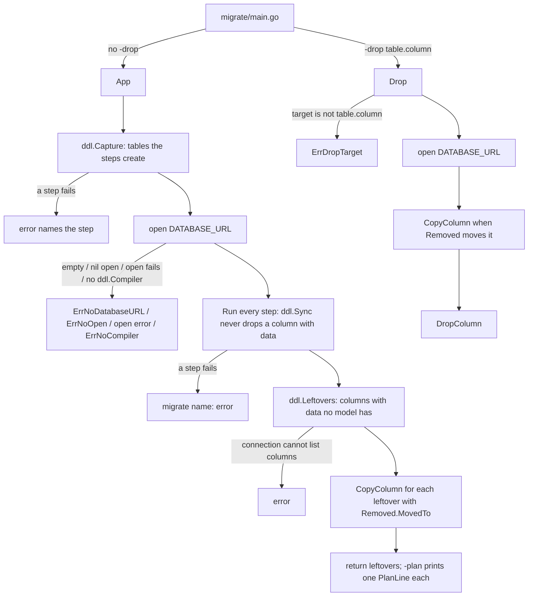

# migrate: Order of operations

1. `migrate/main.go` parses the flags and calls `migrate.App` (or `migrate.Drop` if `-drop` is passed).
2. `App` calls `ddl.Capture` to list the tables the steps create, running them against a dummy recorder.
3. If a step fails, it returns an error naming the step.
4. It opens the database using `DATABASE_URL` and the opener function.
5. If the URL is empty, the opener is nil, opening fails, or the connection is not a `ddl.Compiler`, it returns an error.
6. It calls `Run` to execute every step in order. `ddl.Sync` creates tables and columns but never drops a column with data.
7. If a step fails to run on the real connection, it returns a `migrate name: error`.
8. It calls `ddl.Leftovers` to find columns that contain data but belong to no model in the schema.
9. If the database connection cannot list columns, it returns an error.
10. For each leftover column whose `Removed` entry has a `MovedTo` target, it calls `CopyColumn` to copy its data to the new column.
11. It returns the leftovers. The generated main will loop over them and print one `PlanLine` JSON string each if `-plan` was passed.
12. If `-drop` was passed instead, `Drop` verifies the target has the form `table.column`, returning `ErrDropTarget` if not.
13. It opens the database, calls `CopyColumn` if a `Removed` entry matches and has a `MovedTo` target, and then calls `DropColumn` to actually delete the column.